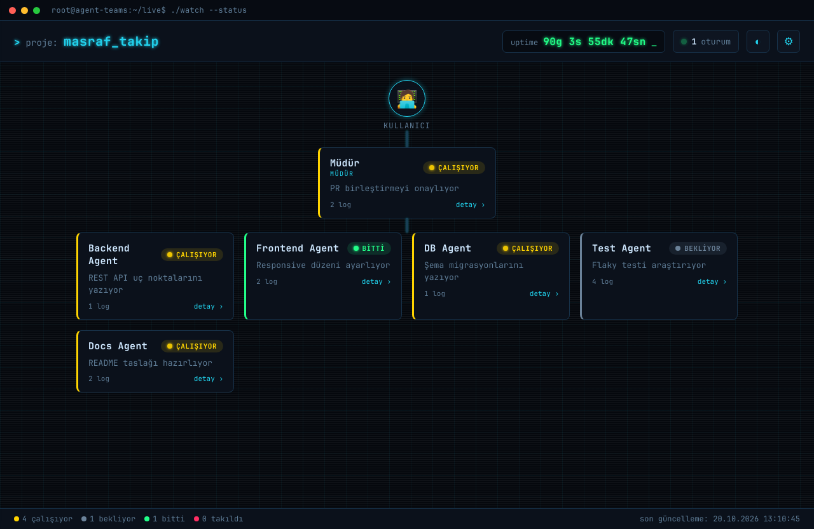
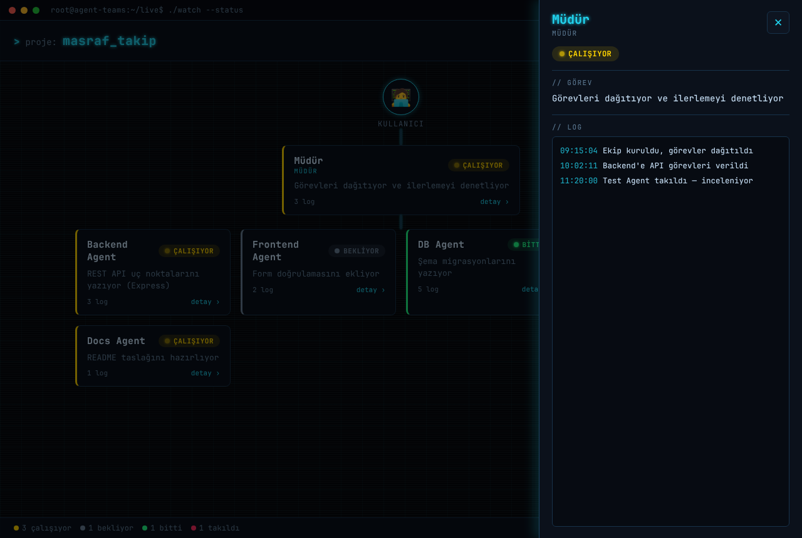

# Agent Dashboard

Claude Code Agent Teams çalışırken hangi agent'ın ne durumda olduğunu
**ofis/organizasyon şeması** tarzında, **canlı güncellenen** bir Electron
masaüstü uygulaması.

## Ekran görüntüleri





Tarayıcıda canlı demo: `docs/demo.html` dosyasını açın
(`node tools/build-web-demo.js` ile yeniden üretilir).

- Üstte hangi proje üzerinde çalışıldığı ve projeye başlanışından bu yana
  akan canlı bir süre sayacı (`2s 14dk 33sn geçti` gibi).
- Ortada organizasyon şeması: en üstte **Kullanıcı**, altında **Müdür**,
  en altta ızgara düzeninde diğer agent'lar.
- Her agent kutusunda: isim, o an yaptığı görev ve renkli durum rozeti:
  - 🟡 **çalışıyor** (sarı) &nbsp; ⚪ **bekliyor** (gri) &nbsp;
    🟢 **bitti** (yeşil) &nbsp; 🔴 **takıldı** (kırmızı)
- Veri kaynağı esnek bir `status.json` dosyası; **2 saniyede bir** otomatik
  yeniden okunur.
- `status.json` yolu ayarlanabilir — böylece farklı projelerin arasında geçiş
  yapabilirsin.
- **Hacker / terminal teması** varsayılan (koyu neon, scanline, glow); header'daki
  ◐ düğmesiyle **açık temaya** geçebilirsin (tercih hatırlanır).
- Bir agent kutusuna **tıklayınca** sağdan kayan **detay/log paneli** açılır —
  görev + zaman damgalı log akışı. `Esc` ya da dışarı tıkla ile kapanır.
- Durumları canlı **hareketlendiren bir simülatör** ve `status.json`'ı
  program içinden güvenle güncelleyen bir **yazıcı (StatusWriter)** dahil.

---

## Kurulum (geliştirme)

Node.js 18+ gerekir.

```bash
npm install
npm start
```

Uygulama açılınca proje kökündeki örnek `status.json` otomatik yüklenir.

---

## status.json formatı

Uygulama şu alanları bekler (fazladan alanlar yok sayılır — format esnektir):

| Alan           | Tip     | Açıklama                                              |
| -------------- | ------- | ---------------------------------------------------- |
| `project_name` | string  | Header'da gösterilen proje adı                       |
| `started_at`   | string  | Projeye başlanış zamanı (ISO 8601) — sayaç bundan sayar |
| `updated_at`   | string  | Son güncelleme zamanı (ISO 8601) — footer'da gösterilir |
| `agents`       | array   | Agent listesi                                        |

Her `agent` nesnesi:

| Alan    | Tip    | Açıklama                                                        |
| ------- | ------ | -------------------------------------------------------------- |
| `name`  | string | Agent adı                                                      |
| `task`  | string | O an yaptığı işin kısa açıklaması                              |
| `state` | string | Durum (aşağıdaki eşlemeye bakın)                               |
| `role`  | string | (opsiyonel) `"manager"` ise bu agent **Müdür** kutusuna çıkar |
| `logs`  | array  | (opsiyonel) detay panelinde gösterilen log satırları          |

`logs` iki formatı da kabul eder:

```json
"logs": ["düz metin satırı"]
"logs": [{ "time": "2026-07-22T11:15:00", "message": "zaman damgalı satır" }]
```

### Durum (`state`) eşlemesi

Serbest metin kabul edilir, şunlara indirgenir:

- **çalışıyor (sarı):** `working`, `çalışıyor`, `running`, `active`, `busy`, `in_progress`
- **bekliyor (gri):** `waiting`, `bekliyor`, `idle`, `queued`, `pending`
- **bitti (yeşil):** `done`, `bitti`, `completed`, `finished`, `success`
- **takıldı (kırmızı):** `stuck`, `takıldı`, `error`, `failed`, `blocked`

Tanınmayan bir değer **bekliyor** sayılır.

### Örnek

Proje kökündeki [`status.json`](./status.json) çalışan bir örnektir:

```json
{
  "project_name": "masraf_takip",
  "started_at": "2026-07-22T09:15:00",
  "updated_at": "2026-07-22T11:29:33",
  "agents": [
    { "name": "Müdür", "role": "manager", "task": "Görevleri dağıtıyor", "state": "working" },
    { "name": "Backend Agent", "task": "REST API yazıyor", "state": "working" },
    { "name": "DB Agent", "task": "Migrasyonlar tamamlandı", "state": "done" },
    { "name": "Test Agent", "task": "Auth testinde takıldı", "state": "stuck" }
  ]
}
```

`started_at` geçmiş bir zaman olduğu için uygulama açıkken sayaç
`şu an − started_at` farkını **saniye saniye** akıtır.

---

## status.json yolunu değiştirme

İki yol var:

1. **Menü:** `Dosya → status.json Seç…` (kısayol `Ctrl+O`)
2. **Ayarlar:** Header'daki ⚙ düğmesine bas, açılan şeritte **Değiştir…**

Seçilen yol `userData` altında saklanır, uygulama tekrar açıldığında hatırlanır.
`Dosya → Yeniden Yükle` (`Ctrl+R`) ile elle de yenileyebilirsin.

---

## Aktif oturum keşfi (otomatik)

Header'daki **oturum** göstergesi, sistemdeki Claude Code oturumlarını
**otomatik** bulur — elle bir şey ayarlamana gerek yok.

- Claude Code her oturumu `~/.claude/projects/<proje>/<id>.jsonl` olarak yazar.
- Bir oturum, transkripti **son 60 sn içinde** güncellenmişse **🟢 aktif**
  sayılır (yani yakın zamanda iş yaptı).
- Göstergeye tıkla → soldan açılan panelde tüm oturumlar; her biri için proje,
  yol (cwd), git dalı, oturum id'si, boyut ve "ne zaman aktifti" bilgisi.

> Not: Bu bir **etkinlik** sinyalidir, "pencere açık mı" değil. Oturum açık ama
> boşta beklerken (senin cevabını beklerken) transkripte yazmadığı için
> "boşta" görünebilir. Eşik `tools/sessions.js` içindeki `ACTIVE_WINDOW_MS`
> ile ayarlanabilir.

## Canlı simülatör (dashboard'u hareketli test et)

Dashboard'u açıp ayrı bir terminalde simülatörü çalıştır — agent'ların durumu
ve log'ları gerçek zamanlı akmaya başlar:

```bash
npm run simulate
# ya da başka bir dosyaya:  node tools/simulate.js C:\proj\status.json
```

Durdurmak için `Ctrl+C`.

## status.json'ı program içinden güncelleme (StatusWriter)

Gerçek bir çalışmayı dashboard'a bağlamak için `tools/status-writer.js`'i
kütüphane olarak kullan:

```js
const StatusWriter = require('./tools/status-writer');
const w = new StatusWriter('C:/proj/status.json');

w.init('masraf_takip');                                   // dosya + started_at
w.setAgent('Müdür',   { role: 'manager', state: 'working', task: 'Dağıtıyor' });
w.setAgent('Backend', { state: 'working', task: 'API yazıyor' });
w.log('Backend', 'GET /expenses eklendi');                // zaman damgalı log
w.setState('Backend', 'done');                            // sadece durum
w.remove('Backend');                                      // agent sil
```

Yazma **atomiktir** (önce geçici dosya, sonra rename) — dashboard okurken
yarım/bozuk JSON görmez.

Komut satırından da kullanılabilir:

```bash
node tools/status-writer.js status.json init "masraf_takip"
node tools/status-writer.js status.json set "Backend" working "API yazıyor"
node tools/status-writer.js status.json log "Backend" "endpoint eklendi"
node tools/status-writer.js status.json rm  "Backend"
```

> İpucu: Claude Code hook'larından (örn. bir agent görev alınca/bitirince)
> bu CLI'yı çağırarak `status.json`'ı otomatik güncelleyebilirsin.

## Windows için .exe / kurulum paketi üretme

[electron-builder](https://www.electron.build/) kullanılır.

```bash
npm install
npm run dist
```

Çıktı `dist/` klasörüne yazılır:

- `Agent Dashboard Setup 1.0.0.exe` — NSIS kurulum sihirbazı
  (kurulum konumu seçilebilir, masaüstü + başlat menüsü kısayolu oluşturur).

Kurulum yapmadan sadece taşınabilir bir klasör istersen:

```bash
npm run pack
```

Çıktı `dist/win-unpacked/` altında `Agent Dashboard.exe` olur.

> Not: `npm run dist` ilk çalıştırmada Electron ikili dosyalarını indirir;
> internet bağlantısı gerekir.

---

## Proje yapısı

```
agent_dashboard/
├── main.js              # Electron ana süreç (pencere, menü, dosya okuma, IPC)
├── preload.js           # Güvenli IPC köprüsü (contextIsolation açık)
├── renderer/
│   ├── index.html       # Arayüz iskeleti + detay/log paneli
│   ├── styles.css       # Hacker (koyu neon) + açık tema
│   └── renderer.js      # okuma, şema çizimi, sayaç, tema, detay paneli
├── tools/
│   ├── status-writer.js # status.json'ı güvenle güncelleyen API + CLI
│   └── simulate.js      # canlı demo/simülatör
├── status.json          # Örnek/test verisi (logs alanı dahil)
├── package.json
└── README.md
```

## Lisans

MIT
